# System architecture

## Goal

Train one policy that plays Geometry Dash levels it has never seen, then run that policy on the real game. Training happens in a simulator written for this project. The real game is used only at inference.

## What kind of RL this is

The setup is online RL in a simulator, followed by sim-to-real transfer.

- It is not offline RL. Offline RL learns from a fixed logged dataset with no environment interaction. Here the agent interacts with the simulator constantly.
- It is not a world model. A world model is a learned network that predicts the next state. The simulator here is hand-written physics, so it does not hallucinate and it is deterministic for a given seed and action sequence.
- It could grow a learned component later (for example, a learned renderer or a learned correction to the physics), but nothing in the plan needs one.

## Components

```mermaid
flowchart LR
    levels[Level data] --> importer[Level importer]
    importer --> compiled[Compiled levels]
    compiled --> engine[Rust engine]
    engine --> bindings[PyO3 bindings]
    bindings --> sim[python/src/sim VecEnv]
    sim --> learner[Learner: CNN policy and PPO]
    learner --> checkpoint[Checkpoint]
    checkpoint --> player[Real-game player]
    game[Real game window] --> player
    player --> game
```

| Component | Location | Status |
|---|---|---|
| Rust engine: physics, levels, renderer, parallel vectorized env | `rust/engine/` | Vertical slice. Placeholder physics and generated levels. |
| PyO3 bindings, built as the Python module `geo_dash_native` | `rust/bindings/` | Done for the current engine API. |
| Typed Python wrapper and config | `python/src/sim/`, `python/src/config.py` | Done. |
| Level importer | `rust/importer/` | Planned. |
| Network, trainer, rollout loop, metrics | `python/src/model/`, `python/src/rollout.py`, `python/src/run_log.py`, `python/src/train.py`, `python/src/eval.py` | Done. |
| Shared preprocessing: frame stack | `rust/engine/` | Done. Grayscale conversion and resizing of real frames are planned. |
| Real-game player: capture, policy, input | `rust/play/` and a play entry point | Planned. |

### Rust engine

The engine owns everything about the game world, and nothing else knows the physics.

- `physics.rs` advances the player one fixed tick at a time (240 ticks per second).
- `level.rs` holds a level and generates one from a seed.
- `render.rs` draws a grayscale frame of the world around the player.
- `frame_stack.rs` keeps the last frames in a stack, newest last.
- `env.rs` is one environment. One agent step runs `frame_skip` ticks, computes the reward, and reports termination.
- `vec_env.rs` runs many environments in parallel with rayon. A finished environment resets itself inside the same step, and the next episode starts on a freshly generated level.

The engine has no Python dependency and `unsafe_code` is forbidden in it. All FFI lives in `rust/bindings/`.

### Python layer

`python/src/sim/vec_env.py` defines the `VecEnv` protocol the learner depends on, and `NativeVecEnv`, which implements it on top of `geo_dash_native`. The learner imports the protocol only, so it can run against a fake environment in tests.

Hyperparameters and simulator settings are required keys in `python/src/configs/`. A run config such as `default.yml` is a short manifest that names one file each from `sim/`, `model/`, and `ppo/`, so switching model size or PPO settings is a one-line change. Each config section is a frozen dataclass.

A run writes weights to `checkpoints/<run_name>/` (`latest.pt`, `best.pt`, and numbered snapshots) and metrics to `runs/<run_name>/` (`updates.csv`, `epochs.csv`, `eval.csv`, and TensorBoard data). Both stay out of git. `mise run run:tensorboard` shows live graphs for every run. Training episode metrics cover the last `metrics_window_episodes` finished episodes, because many updates finish none. Ctrl+C finishes the current update, including any evaluation or checkpoint due, then saves `latest.pt` and exits.

## Interface contract

The current contract between the simulator and the learner. Changing it means changing the engine, the bindings, the stub in `python/typings/geo_dash_native.pyi`, the wrapper, and the tests together.

| Item | Definition |
|---|---|
| Action | `uint8`, one per environment. `0` releases the button, `1` holds it. |
| Observation | `uint8` array of shape `(N, S, H, W)`, grayscale, row 0 at the top. `N` is the number of environments and `S` is `frame_stack`, with the newest frame last. |
| Step result | `obs`, `rewards (N,)`, `dones (N,)`, `progress_fraction (N,)`. |
| Auto reset | After a terminal step, every frame in that environment's stack is the first frame of the next episode. `rewards`, `dones`, and `progress_fraction` describe the episode that ended. |
| Reward | Change in progress fraction, minus `death_penalty` on death, plus `completion_bonus` on completion. |
| Frame skip | One step runs `frame_skip` physics ticks with the same action. |
| Determinism | The same seed and the same actions give the same frames and rewards. |

## Sim-to-real

The policy sees only pixels, in both settings. The simulator is useful only if the policy transfers, so the work that closes the gap is the core of the project, not an add-on.

1. **Fidelity.** Record real runs with their inputs, replay the inputs in the engine, and compare death positions and frames. This replay test gates every physics change. The current physics constants are placeholders until it exists.
2. **Observation parity.** The renderer and the real-game capture must feed the network through one shared preprocessing step, written in Rust for speed. It handles grayscale conversion, resizing, and stacking, and it outputs `uint8`. Scaling to floats happens on the training device, which keeps host-to-device transfers four times smaller than `float32`. A real frame is much busier than a simulator frame (backgrounds, glow, particles, color triggers). The renderer needs visual randomization, or the policy will not read real frames.
3. **Timing parity.** The real loop has capture latency, inference latency, and click latency, and the game does not tick in lockstep with the agent. The engine should apply a randomized action delay in training. The real loop must also keep frames evenly spaced at the training step interval, because the frame stack's velocity signal depends on it.
4. **Real-game player.** Capture, input, and window handling live in Rust. The player assumes the game runs windowed at 1280x720 at the top-left of the primary display, as the old capture code did.

## Generalization

The goal is unseen levels, so the data split matters as much as the algorithm.

- Keep a held-out set of levels that training never touches, and report progress on it.
- Train on a large and varied pool: imported levels plus generated ones. A small fixed pool lets the policy memorize timing for each level.
- Report both training-level and held-out progress, because the gap between them measures memorization.

## Learning stack

The model design, as decided so far:

| Item | Decision |
|---|---|
| Observation | Grayscale, one channel per frame, at the configured `obs_height_px` by `obs_width_px` (72 by 128 today). |
| Model input | The last 4 frames stacked as channels, shape `(N, 4, H, W)`, `uint8` from Rust, scaled to floats on the device by dividing by 255. |
| Encoder | Stock IMPALA CNN: three sections with 16, 32, and 32 channels, flattened into 256 features. |
| Memory | The frame stack only. No LSTM in the baseline. |
| Heads | One linear policy head and one linear value head on the shared features. |
| Algorithm | PPO-style actor-critic updates. |
| Training | Batched across environments and rollout steps. |

The network and trainer are rewritten against the new `VecEnv` contract, and checkpoints from the previous version are not compatible with it. The stack size is a required config key like every other hyperparameter.

### Frame stack

One frame shows height but not vertical speed, and the same height occurs both rising and falling. A 4-frame stack supplies that motion without the sequence handling an LSTM adds to PPO. Four frames rather than two, because the cube moves less than a pixel per step near the top of a jump, so adjacent frames can look identical.

Stacking happens in Rust, in `rust/engine/src/frame_stack.rs`, so the real-game player can reuse it. Each environment keeps its own stack, with the newest frame last. After a terminal step, that environment's stack is refilled with the first frame of the next episode, so frames never cross episodes.

An LSTM after the 256 features is a possible later experiment, not part of the baseline. Test it if the policy needs information that has left the screen, if held-out progress stalls, or if real-game latency makes frame spacing too uneven for a stack. Compare 1, 2, and 4 frames again when ship mode lands, because holding there changes vertical speed continuously.

### Grayscale

Obstacles are recognized by shape, so color adds input size and visual noise. Real-game frames are converted to grayscale in the shared preprocessing step. Color changes in the game still show up as brightness changes, so visual randomization has to vary brightness and contrast too.

### Batched training

Collecting experience runs one forward pass over all environments, with input `(N, 4, H, W)`. Each PPO update flattens the rollout across steps and environments, shuffles the samples, and trains on minibatches of shape `(B, 4, H, W)`. Each sample carries its own history, so shuffling is safe. Keep rollouts as `uint8` and convert minibatches to float on the device.

Samples stay independent through the network, and they only combine when gradients are averaged over the minibatch. Batch normalization would break that independence, so adding it needs a deliberate decision. The real-game player runs the same network with a batch of 1.

### Hardware

Training runs on Apple silicon first (MPS), then CUDA, then CPU. The simulator runs on CPU cores, so rendering cost and training compete for the same machine. The benchmark task (`mise run run:bench`) measures simulator throughput.

## Current state

The repository holds a vertical slice that runs end to end:

- Cube physics on flat ground, with spikes as the only obstacle.
- Generated levels: spikes with random gaps, regenerated every episode.
- A grayscale renderer with a player, ground, and spikes.
- Parallel stepping across environments, exposed to Python.
- A random-policy benchmark, which reaches roughly 30,000 environment steps per second on 16 environments at 128x72 on an Apple silicon laptop.

Everything numeric in the physics (run speed, gravity, jump speed, hitboxes) is a placeholder and not calibrated against the real game.

## Roadmap

Each phase has an exit condition so it is clear when to move on.

1. **Learner on the toy sim.** IMPALA network with the frame stack, batched PPO trainer, and a train entry point. Exit: the policy clears generated levels.
2. **Level importer.** Parse real level data into the engine's level type. Exit: an imported level loads and renders.
3. **Fidelity.** Record real runs, add the replay test, and calibrate physics. Exit: replayed inputs reproduce real death positions.
4. **Engine coverage.** Solid blocks, other gamemodes, orbs, pads, portals, speed changes, and triggers, in the order the target levels need them.
5. **Visual parity.** Richer rendering with randomization, and the shared preprocessing step.
6. **Real-game player.** Capture, input, and inference. Exit: the trained policy plays the real game on levels held out of training.

## Open questions

- Which level source to import from, and how to keep copied levels local.
- How faithful the renderer must be before the policy transfers, and whether to randomize visuals or render the real sprites.
- Which obstacle types to model first.
- Whether grayscale keeps objects apart that differ mainly by color, such as orbs and pads. Check this before modeling them.
