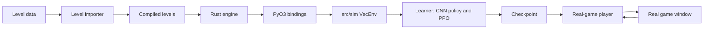

# System architecture

## Goal

Train one policy that plays Geometry Dash levels it has never seen, then run that policy on the real game. Training happens in a simulator written for this project. The real game is used only at inference.

## What kind of RL this is

The setup is online RL in a simulator, followed by sim-to-real transfer.

- It is not offline RL. Offline RL learns from a fixed logged dataset with no environment interaction. Here the agent interacts with the simulator constantly.
- It is not a world model. A world model is a learned network that predicts the next state. The simulator here is hand-written physics, so it does not hallucinate and it is deterministic for a given seed and action sequence.
- It could grow a learned component later (for example, a learned renderer or a learned correction to the physics), but nothing in the plan needs one.

## Components

| Component | Location | Status |
|---|---|---|
| Rust engine: physics, levels, renderer, parallel vectorized env | `rust/engine/` | Vertical slice. Placeholder physics and generated levels. |
| PyO3 bindings, built as the Python module `geo_dash_native` | `rust/bindings/` | Done for the current engine API. |
| Typed Python wrapper and config | `src/sim/`, `src/config.py` | Done. |
| Level importer | `rust/importer/` | Planned. |
| Network, trainer, rollout loop | `src/model/` and a train entry point | Planned. |
| Real-game player: capture, preprocessing, policy, input | `rust/play/` and a play entry point | Planned. |

### Rust engine

The engine owns everything about the game world, and nothing else knows the physics.

- `physics.rs` advances the player one fixed tick at a time (240 ticks per second).
- `level.rs` holds a level and generates one from a seed.
- `render.rs` draws a grayscale frame of the world around the player.
- `env.rs` is one environment. One agent step runs `frame_skip` ticks, computes the reward, and reports termination.
- `vec_env.rs` runs many environments in parallel with rayon. A finished environment resets itself inside the same step, and the next episode starts on a freshly generated level.

The engine has no Python dependency and `unsafe_code` is forbidden in it. All FFI lives in `rust/bindings/`.

### Python layer

`src/sim/vec_env.py` defines the `VecEnv` protocol the learner depends on, and `NativeVecEnv`, which implements it on top of `geo_dash_native`. The learner imports the protocol only, so it can run against a fake environment in tests.

Hyperparameters and simulator settings are required keys in `src/configs/*.yml`. Each config section is a frozen dataclass.

## Interface contract

The current contract between the simulator and the learner. Changing it means changing the engine, the bindings, the stub in `typings/geo_dash_native.pyi`, the wrapper, and the tests together.

| Item | Definition |
|---|---|
| Action | `uint8`, one per environment. `0` releases the button, `1` holds it. |
| Observation | `uint8` array of shape `(N, H, W)`, grayscale, row 0 at the top. `N` is the number of environments. |
| Step result | `obs`, `rewards (N,)`, `dones (N,)`, `progress_fraction (N,)`. |
| Auto reset | After a terminal step, `obs` already holds the first frame of the next episode. `rewards`, `dones`, and `progress_fraction` describe the episode that ended. |
| Reward | Change in progress fraction, minus `death_penalty` on death, plus `completion_bonus` on completion. |
| Frame skip | One step runs `frame_skip` physics ticks with the same action. |
| Determinism | The same seed and the same actions give the same frames and rewards. |

## Sim-to-real

The policy sees only pixels, in both settings. The simulator is useful only if the policy transfers, so the work that closes the gap is the core of the project, not an add-on.

1. **Fidelity.** Record real runs with their inputs, replay the inputs in the engine, and compare death positions and frames. This replay test gates every physics change. The current physics constants are placeholders until it exists.
2. **Observation parity.** The renderer and the real-game capture must feed the network through one shared preprocessing step. A real frame is much busier than a simulator frame (backgrounds, glow, particles, color triggers). The renderer needs visual randomization, or the policy will not read real frames.
3. **Timing parity.** The real loop has capture latency, inference latency, and click latency, and the game does not tick in lockstep with the agent. The engine should apply a randomized action delay in training.
4. **Real-game player.** Capture, input, and window handling live in Rust. The player assumes the game runs windowed at 1280x720 at the top-left of the primary display, as the old capture code did.

## Generalization

The goal is unseen levels, so the data split matters as much as the algorithm.

- Keep a held-out set of levels that training never touches, and report progress on it.
- Train on a large and varied pool: imported levels plus generated ones. A small fixed pool lets the policy memorize timing for each level.
- Report both training-level and held-out progress, because the gap between them measures memorization.

## Learning stack

The policy is an IMPALA-style CNN with a recurrent or frame-stacked input (to be decided), trained with PPO-style actor-critic updates. This is unchanged from the previous version. The network and trainer are rewritten against the new `VecEnv` contract, and checkpoints from the previous version are not compatible with it.

Training runs on Apple silicon first (MPS), then CUDA, then CPU. The simulator runs on CPU cores, so rendering cost and training compete for the same machine. The benchmark task (`mise run run:bench`) measures simulator throughput.

## Current state

The repository holds a vertical slice that runs end to end:

- Cube physics on flat ground, with spikes as the only obstacle.
- Generated levels: spikes with random gaps, regenerated every episode.
- A grayscale renderer with a player, ground, and spikes.
- Parallel stepping across environments, exposed to Python.
- A random-policy benchmark, which reaches roughly 30,000 environment steps per second on 16 environments at 128x72 on an Apple silicon laptop.

Everything numeric in the physics (run speed, gravity, jump speed, hitboxes) is a placeholder and not calibrated against the real game.

## Roadmap

Each phase has an exit condition so it is clear when to move on.

1. **Learner on the toy sim.** Network, PPO trainer, and a train entry point. Exit: the policy clears generated levels.
2. **Level importer.** Parse real level data into the engine's level type. Exit: an imported level loads and renders.
3. **Fidelity.** Record real runs, add the replay test, and calibrate physics. Exit: replayed inputs reproduce real death positions.
4. **Engine coverage.** Solid blocks, other gamemodes, orbs, pads, portals, speed changes, and triggers, in the order the target levels need them.
5. **Visual parity.** Richer rendering with randomization, and the shared preprocessing step.
6. **Real-game player.** Capture, input, and inference. Exit: the trained policy plays the real game on levels held out of training.

## Open questions

- Which level source to import from, and how to keep copied levels local.
- How faithful the renderer must be before the policy transfers, and whether to randomize visuals or render the real sprites.
- Whether the policy needs memory (an LSTM) or whether a short frame stack is enough.
- Which obstacle types to model first.
